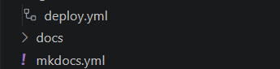

## Exemples Codi Mkdocs.yml deploy.yml

## 1. Què és mkdocs.yml?

El fitxer mkdocs.yml és el fitxer principal de configuració de MkDocs. Serveix per configurar el nom de la web, el tema visual i el menú de navegació.

## 2. Què és deploy.yml?

El fitxer deploy.yml defineix un flux de treball automatitzat de GitHub Actions, si el projecte utilitza aquest sistema. Serveix per executar tasques automàticament, com ara generar i publicar la documentació web.

# Ejemplo plugin
Live Server es una extensión que permite abrir una página web en el navegador y ver automáticamente los cambios realizados en el código, sin tener que actualizar la página manualmente cada vez.

## Ejemplo

si estás creando una web con HTML y CSS, puedes instalar Live Server y pulsar en Go Live para visualizar la página en el navegador.